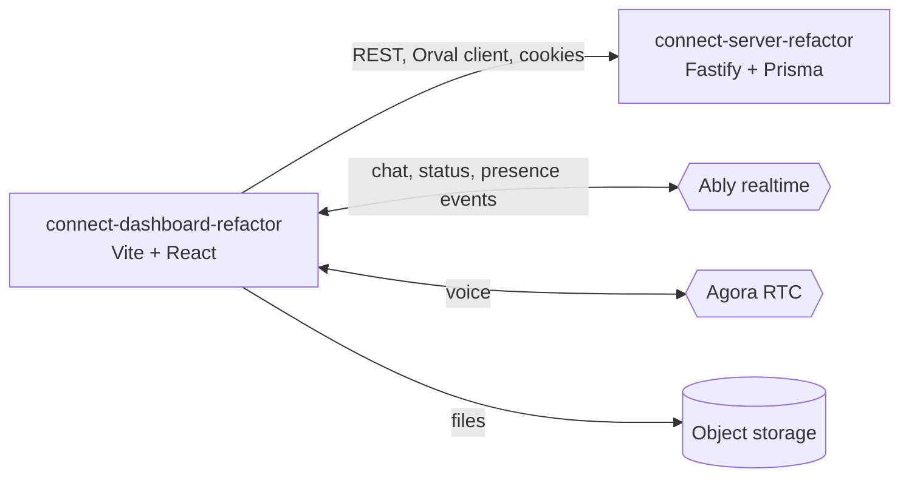

# Connect Dashboard

Web operator console for a multi-tenant ambulance-fleet communications platform: manage companies, bases, ambulances and users, follow shift status, chat and talk over radio.

**Status:** prototype / work in progress, not presented as production. The realtime (Ably token) and radio (Agora token) endpoints it calls are not in `connect-server-refactor`, so it cannot run end to end from this repository set alone.

## What it does

- Tenant administration screens: company groups, companies, units, bases, ambulances, users, modules (`src/pages/protected`).
- Ambulance control view with live shift and status updates.
- Chat with realtime delivery and read receipts over Ably (`src/websocket/use-cases`).
- Radio and voice over Agora (`agora-rtc-sdk-ng`) and a Cloudflare RealtimeKit integration.
- Driver management and per-company external integrations.
- Permission-aware navigation: sidebar and routes depend on the user's modules and role (`src/hooks/use-get-user-permissions.ts`).
- Local cache with WatermelonDB (`src/database`).

## Architecture



- Routing with React Router (`src/router`), pages grouped as `public` (sign-in) and `protected`.
- Server state through TanStack Query; client state through Zustand.
- Realtime handlers are split per event type under `src/websocket/use-cases`.

## Key engineering decisions

- Contract-first API client: `orval.config.ts` generates typed React Query hooks from the committed `swagger.json` into `src/http/generated` (git-ignored).
- Environment validated at boot with zod (`src/env/index.ts`).
- One Axios instance with credentials and a shared error toast (`src/lib/api.ts`).
- Realtime logic isolated from UI in per-event handlers rather than inside components.

## Known gaps

- No automated tests and no CI.
- `swagger.json` is a snapshot of the server contract and can drift from `connect-server-refactor`.
- Ably-token and radio endpoints live outside this repository set.
- The `start` script references an `orvalProd` script that is not defined.

## Tech stack

React 19, Vite 7, TypeScript, Tailwind CSS 4, Radix UI, TanStack Query, Zustand, React Router 7, Orval, Axios, Ably, Agora Web SDK, WatermelonDB, zod, Biome.

## Getting started

Prerequisites: Node 20+, Yarn.

```bash
cp .env.example .env
yarn install
yarn orval          # generate src/http/generated
yarn vite           # or: yarn dev (runs orval first)
```

| Variable | Purpose |
|---|---|
| `VITE_HTTP_API_URL` | Base URL of the REST API |
| `VITE_WEBSOCKET` | Realtime endpoint configuration |
| `VITE_STORAGE_URL` | Public base URL of the object storage |

## Testing

None yet. Lint with `yarn lint`; type-check with `yarn tsc -b`.

## Project structure

```text
src/pages/        public and protected pages
src/websocket/    Ably connection and per-event handlers
src/components/   UI primitives, dialogs, sidebar
src/database/     WatermelonDB setup
src/lib/          Axios instance, query client
swagger.json      API contract used by Orval
```

## Related repositories

The Connect family:

- [connect-server-refactor](https://github.com/mkwitko/connect-server-refactor) - REST API
- [connect-dashboard-refactor](https://github.com/mkwitko/connect-dashboard-refactor) - this dashboard
- [connect-app-refactor](https://github.com/mkwitko/connect-app-refactor) - mobile app
- [connect-driver-app](https://github.com/mkwitko/connect-driver-app) - driver mobile app
- [connect-comms-app](https://github.com/mkwitko/connect-comms-app) - communications-only mobile app

## License

All rights reserved. Source available for portfolio review.
