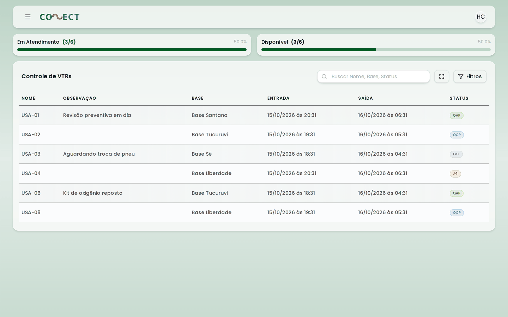
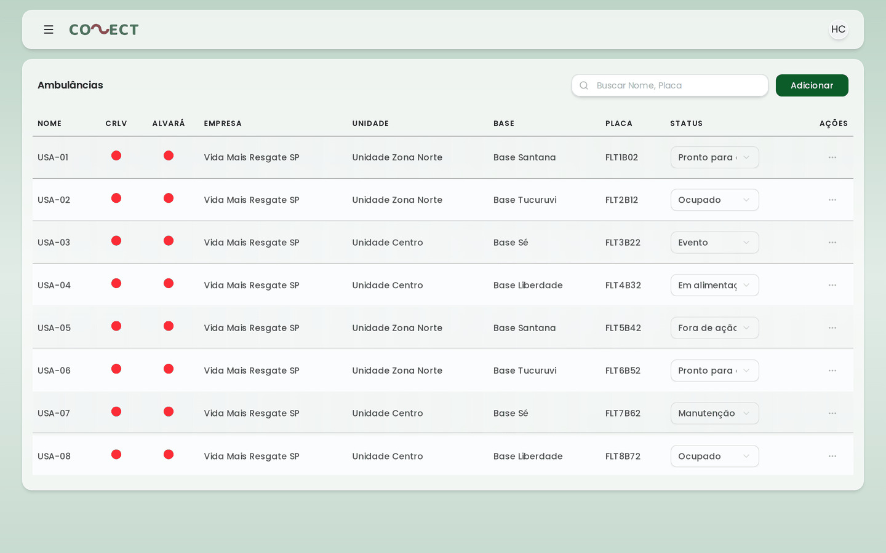
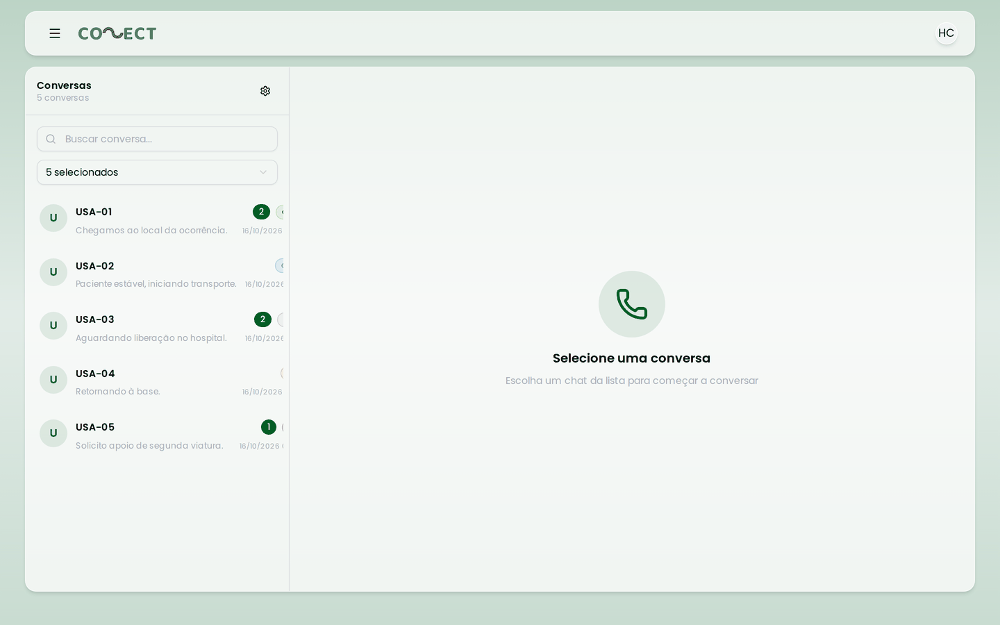
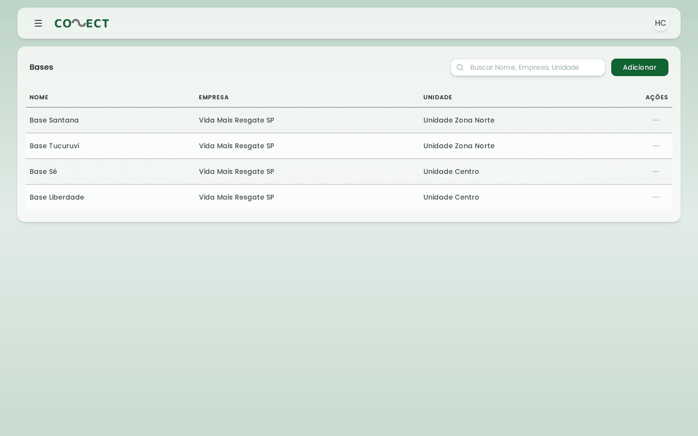
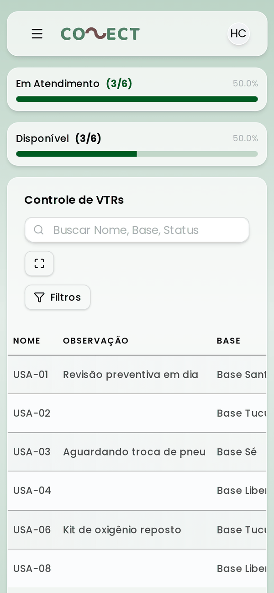
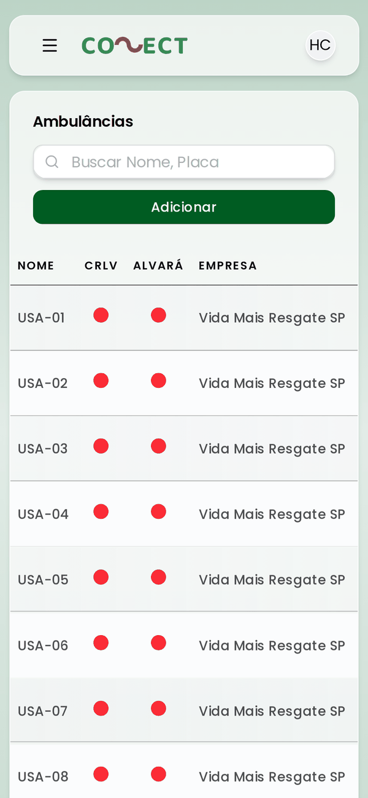
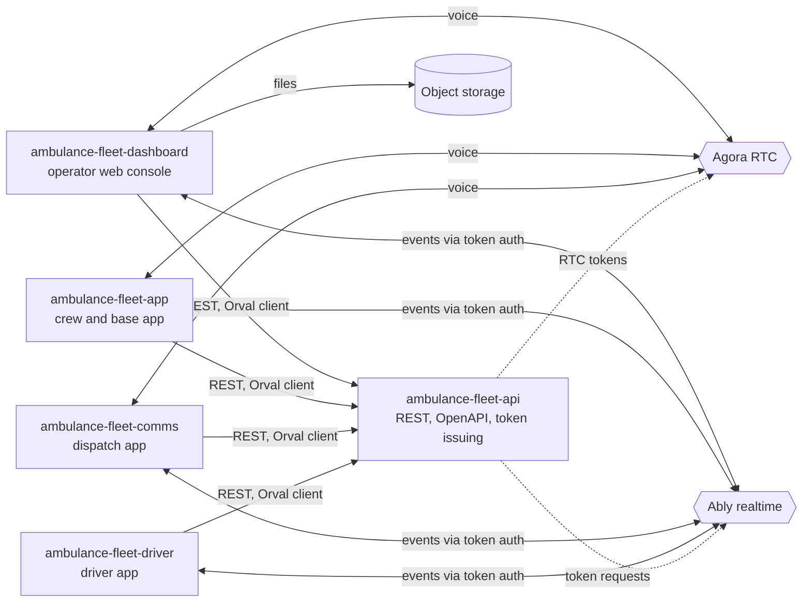
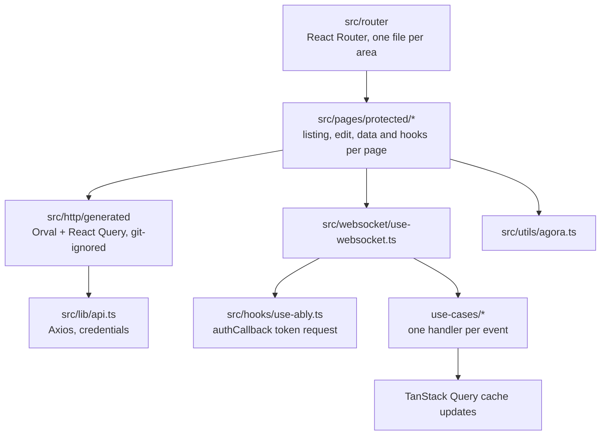
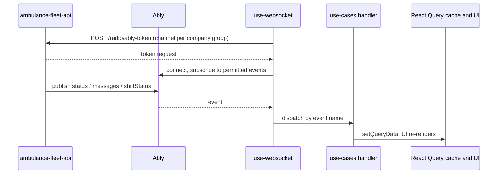

# ambulance-fleet-dashboard

Web operator console for a multi-tenant ambulance-fleet platform: administer companies, bases, ambulances and users, watch live shift and status, chat with crews and talk to them over radio.

**Status:** prototype, not presented as production. It was built against a backend API that is a sibling repository; see "Known gaps".

## What it does

- Tenant administration: company groups, companies, units, bases, ambulances, users, billing modules (`src/pages/protected`).
- Ambulance control view with live shift and status updates (`src/pages/protected/ambulance-control`).
- Chat with realtime delivery and read receipts over Ably (`src/pages/protected/chats`, `src/websocket/use-cases`).
- Radio: start a push-to-talk call to an ambulance and join the Agora channel from the browser (`src/pages/protected/radio`, `src/utils/agora.ts`).
- Dispatch-user (comms) and driver management, and per-company external integrations.
- Permission-aware navigation: sidebar and routes depend on the user's roles (`src/hooks/use-get-user-permissions.ts`, `src/utils/permissions.ts`).
- Notification sound for incoming messages.

## Screenshots

Captured with Playwright against the Vite dev server, with API responses served by route mocks and fictitious data (no real backend or customer data). The header logo still shows the legacy product name.

<table>
<tr><td width="50%"><br><sub>Ambulance control board (desktop). The header logo still shows the legacy name.</sub></td><td width="50%"><br><sub>Ambulance list with unit, base and status selector (desktop).</sub></td></tr>
<tr><td width="50%"><br><sub>Chat conversation list with unread counts (desktop).</sub></td><td width="50%"><br><sub>Bases list (desktop).</sub></td></tr>
<tr><td width="50%"><br><sub>Control board (mobile).</sub></td><td width="50%"><br><sub>Ambulance list (mobile).</sub></td></tr>
</table>

## Architecture

System context:



Inside this app:



Realtime event flow:



Boundaries:

- Server state through TanStack Query; local UI state stays in components and hooks.
- Pages are organized per area with `data/` (query wiring) and `hooks/` (behaviour) next to the view.
- Realtime handlers are separate from components and only touch the query cache.

## Key engineering decisions and trade-offs

- Contract-first API client: `orval.config.ts` generates typed React Query hooks from the committed `swagger.json` into `src/http/generated`. Trade-off: the snapshot can drift from the live API.
- Realtime events are subscribed per role: an event is only subscribed when the user has the matching permission (`src/websocket/use-websocket.ts`, `src/hooks/use-ably.ts`).
- Ably uses token auth, one channel per company group; no realtime key is bundled (`src/hooks/use-ably.ts`).
- One handler per event type maps realtime events to cache updates (`src/websocket/use-cases/*`).
- Radio calls ask the API for an RTC token and track the token lifetime to end the call on expiry (`src/pages/protected/radio/radio-listing/data/use-radio-data.tsx`).
- Environment validated at boot with zod (`src/env/index.ts`).

## Tech stack

React 19, Vite 7, TypeScript, Tailwind CSS 4, Radix UI, TanStack Query, React Router 7, Orval, Axios, Ably, Agora Web SDK, RxDB (installed, offline queue code is commented out), zod, Biome.

## Getting started

Prerequisites: Node 20+, Yarn.

```bash
cp .env.example .env
yarn install
yarn orval          # generate src/http/generated from swagger.json
yarn vite           # or: yarn dev (runs orval first)
```

| Variable | Purpose |
| --- | --- |
| `VITE_HTTP_API_URL` | Base URL of the REST API |
| `VITE_WEBSOCKET` | Realtime endpoint setting required by the env schema |
| `VITE_STORAGE_URL` | Public base URL of the object storage |

## Known gaps

- No automated tests and no CI.
- `swagger.json` is a snapshot of the API contract and can drift from `ambulance-fleet-api`.
- Offline message queue (`src/database`, `use-offline-hook.ts`) is not active.

## Testing

None yet. Lint with `yarn lint`; type-check with `yarn tsc -b` (needs the generated client).

## Project structure

```text
src/pages/        protected pages per area
src/router/       route definitions
src/websocket/    Ably subscriptions and per-event handlers
src/components/   UI primitives, dialogs, sidebar
src/hooks/        Ably, permissions, search
src/lib/          Axios instance, query client
swagger.json      API contract used by Orval
```

## Related repositories

- [ambulance-fleet-api](https://github.com/mkwitko/ambulance-fleet-api): REST API
- [ambulance-fleet-app](https://github.com/mkwitko/ambulance-fleet-app): crew and base mobile app
- [ambulance-fleet-comms](https://github.com/mkwitko/ambulance-fleet-comms): dispatch communications app
- [ambulance-fleet-driver](https://github.com/mkwitko/ambulance-fleet-driver): driver app

## License

All rights reserved. Source available for portfolio review.
